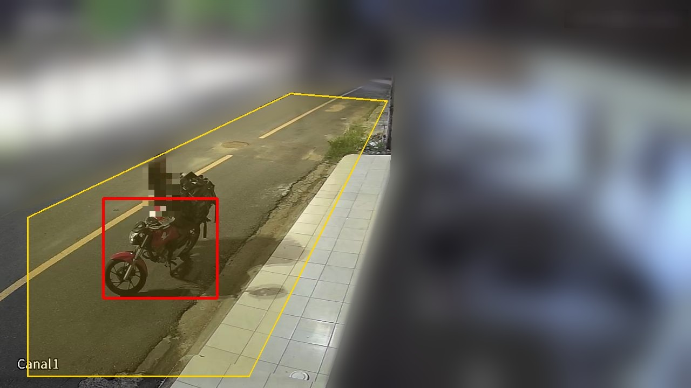
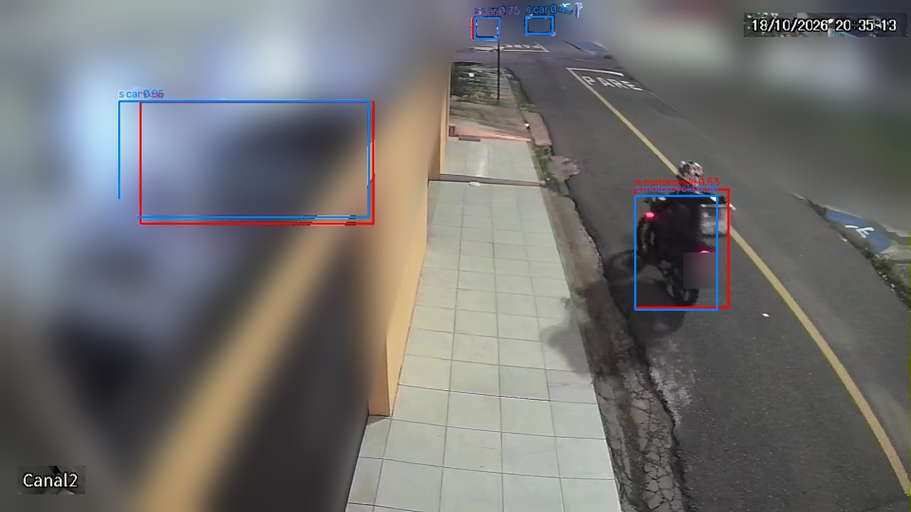
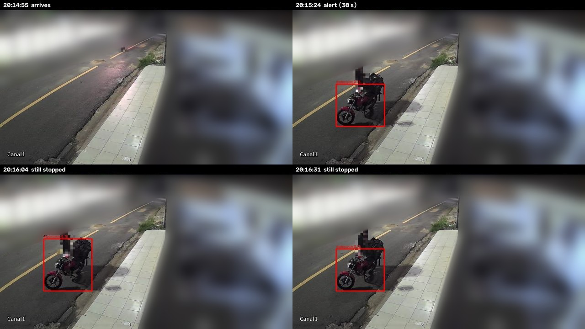
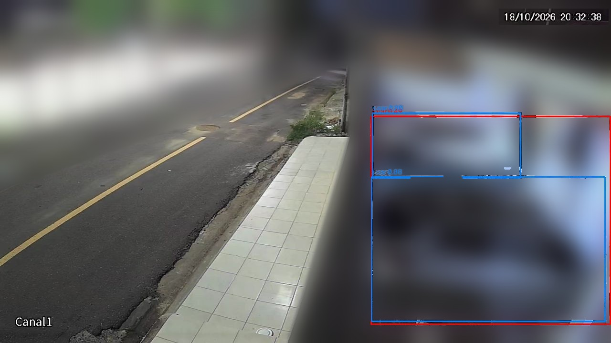

# HomeView Sentinel

An always-on service on a home Mac that watches the street-facing cameras of a
DVR, notices when a **motorcycle or car stops in front of the house and
stays there**, and sends a push notification to the iPhone within seconds, with a
picture of what is there.

Passing traffic is ignored. Only a vehicle that stays stopped inside a zone
(by default 30 s for a motorcycle, 2 min for a car) produces an alert. Video
never leaves the home network.



*The first real detection, on 2026-10-18 at 20:15. A food delivery motorcycle
stopped at the curb in front of the garage. This is the snapshot Sentinel
attaches to the push: the vehicle in red, the "Calçada" zone in yellow. People
are pixelated and the house is blurred for privacy.*

The push that arrived on the iPhone, with that picture attached:

> **Moto parada em frente de casa**
> Garagem · Calçada · parada há 30 s · 20:15

---

## How it works

```
                 RTSP (one session per camera)
  DVR ─────────────────────────────────────────▶ go2rtc gateway ──▶ local restreams
                                                  (container)             │
                                                                          ▼
  iPhone ◀── ntfy app ◀── ntfy server ◀── notifier ◀── MQTT ◀── detector (native)
     ▲        (push)      (container)    (native)   (Mosquitto)  FFmpeg + VideoToolbox
     │                         │                                  YOLO on CoreML
     └──── Tailscale ──────────┘                                  tracking, zones, dwell
         (away from home)        ntfy.sh only wakes the phone up
```

1. **Stream gateway.** [go2rtc](https://github.com/AlexxIT/go2rtc) is the only
   component that talks to the DVR. It logs in with a dedicated **live-view-only
   DVR user** and restreams the watched cameras on the Mac. Any number of
   readers share one DVR session per stream.
2. **Detector.** This is a native Python process, because containers on macOS
   cannot use the hardware decoder or the Neural Engine.
   - FFmpeg decodes each camera's main stream with VideoToolbox at 5 fps and
     scales it to 1280x720. The DVR sends a squeezed 960x1080 picture, and this
     restores 16:9.
   - A YOLO11 model exported to CoreML finds cars, motorcycles and people.
   - A person sitting on a motorcycle becomes its rider.
   - Vehicles are tracked across frames and placed in the camera's zones.
3. **Dwell alerts.** A per-vehicle state machine decides when a vehicle has
   *stopped and stayed*, which is different from just passing by.
   - It publishes one `dwell.started` event, with a snapshot, when the vehicle
     has been stopped longer than the threshold.
   - It publishes `dwell.ended` when the vehicle leaves.
   - A cooldown stops the same vehicle from alerting twice.
4. **Event bus.** Components talk only through MQTT, on
   `sentinel/v1/events/<camera>` and `sentinel/v1/status/<component>`. Messages
   follow a versioned JSON contract
   ([`contracts/event.v1.schema.json`](contracts/event.v1.schema.json)). The
   detector never knows who listens, so a TV app or anything else can subscribe
   later without changing detection.
5. **Notifier.** It turns events into pushes in Portuguese. It sends them
   through a self-hosted [ntfy](https://ntfy.sh) server, with the snapshot
   attached, quiet hours, and an alert when the detector goes offline.
   - The public ntfy.sh server is used only as the iOS wake-up relay. The
     message and the picture stay on the Mac.
   - Away from home, the iPhone reaches the server through Tailscale.
     Nothing is port-forwarded.

### Seeing it work

The courier arriving on the street camera, as each model sees it (yolo11n in
red, yolo11s in blue):



The same stop on the garage camera, from arrival to well after the alert:



Several other motorcycles drove past during that hour. None stayed in view for
more than a few seconds, so none of them would have produced an alert.

Why the larger model: yolo11n (red) merges or loses the parked cars from frame
to frame, which would break tracks and restart dwell timers. yolo11s (blue)
holds each car steadily. Both take under 3 ms per frame on the Neural Engine.



## Status

Work in progress: **24 of 35 tasks** of the first OpenSpec change are done.

**Built and tested:**
- Configuration and Keychain secrets.
- The DVR login probe and the go2rtc config.
- The event contract and the MQTT client.
- The whole detector: frame reader, CoreML inference, riders, tracking, zones,
  the dwell state machine and snapshots.
- The notification messages and the ntfy client.
- Clip recording, replay and zone preview tools.

**Validated on the real hardware** (Mac, DVR, iPhone): see
[docs/spike-notes.md](docs/spike-notes.md).
- Apple `container` works under launchd. Two workarounds are needed: `container
  run` does not pass on SIGTERM, and published ports need care.
- go2rtc against the DVR. One DVR session serves any number of readers. go2rtc
  logs the DVR password in the stream URL when a connection fails, so its output
  must be filtered before it reaches a log.
- VideoToolbox decodes a camera's main stream at 5 fps for about 9% of one CPU
  core.
- yolo11s on the main stream was chosen over yolo11n and over the substream.
- Pushes arrive instantly on the locked iPhone, on Wi-Fi and on mobile data,
  with the picture and correct Portuguese accents.

**Still to do:**
- The gateway, Mosquitto and ntfy containers, the notifier service, and the
  launchd agents.
- `make up` / `make down` / `make status` / `make logs`.
- Calibrating the zones with daytime and nighttime clips.
- A one-hour resource measurement and a manual verification checklist.

## Repository layout

| Path | What is in it |
| --- | --- |
| [`openspec/`](openspec/) | The spec-driven plan: [proposal](openspec/changes/stopped-vehicle-alerts/proposal.md), [design](openspec/changes/stopped-vehicle-alerts/design.md), [tasks](openspec/changes/stopped-vehicle-alerts/tasks.md), and one spec per capability (stream gateway, vehicle detection, dwell alerts, event bus, phone notifications, service runtime). |
| `src/sentinel/` | The Python package: `config`, `secrets`, `rtsp_probe`, `gateway/`, `bus/`, `detector/`, `notifier/`. |
| `tests/` | Unit tests, including a fake RTSP server and scripted detections replayed through the real pipeline. |
| `contracts/` | The JSON Schema of the MQTT events. |
| `config/sentinel.example.yaml` | Cameras, zones, thresholds, quiet hours. Copy it to `config/sentinel.yaml`, which is not committed. |
| `docs/spike-notes.md` | What was measured on the real Mac, DVR and iPhone, and what it changed. |
| `scripts/` | The spike scripts (decode benchmark, model comparison, test pushes). |
| `models/` | Exported CoreML models (not committed) and their versions. |
| `.claude/`, `.codex/` | OpenSpec commands and skills for Claude Code and Codex. |

## How it was built: OpenSpec

The project is planned with [OpenSpec](https://github.com/Fission-AI/OpenSpec).

- **The change.** Everything in this first version is one change,
  [`stopped-vehicle-alerts`](openspec/changes/stopped-vehicle-alerts/), with:
  - a proposal (why and what);
  - a design (17 decisions, risks, open questions);
  - six capability specs, written as requirements with WHEN/THEN scenarios;
  - a task list.
- **One commit per task.** Each task is a single
  [Conventional Commit](https://www.conventionalcommits.org/) containing the
  code, its tests and the ticked box, and every commit passes `make test`.
  Problems found later get their own `fix(...)` commits; history is never
  rewritten.
- **Spikes first.** Before building the services, "spike" tasks tested the
  risky assumptions on the real Mac, DVR and iPhone. Their findings are in
  `docs/spike-notes.md` and feed back into the design.

## Requirements

- A Mac with Apple silicon on macOS 26, plus [uv](https://docs.astral.sh/uv/),
  FFmpeg (`brew install ffmpeg`) and Apple's
  [`container`](https://github.com/apple/container).
- A DVR (or any camera with RTSP), with a user that can only
  view live video.
- An iPhone with the ntfy app. To get alerts away from home, Tailscale on both
  the Mac and the iPhone.

## Getting started

```sh
make setup      # install dependencies, export the YOLO model to CoreML
make secrets    # store the DVR login and generate service credentials in the Keychain
cp config/sentinel.example.yaml config/sentinel.yaml   # set cameras and zones
make test

# Calibrate the zones on real footage:
make record CAMERA=garagem MINUTES=10            # save a clip from the gateway
make replay CLIP=clips/<clip>.mp4 CAMERA=garagem # print the events it would produce
make zone-preview CAMERA=garagem                 # draw the zones on a live frame
```

Running everything as background services (`make up`) is not built yet; see
[Status](#status).

## Security and privacy

- **Credentials.** The DVR password, broker passwords and ntfy tokens live only
  in the macOS Keychain. They never go in code, config files, container images,
  events or logs.
- **DVR access.** Sentinel uses its own DVR user, limited to live view, and reads
  RTSP only. A rejected login is never retried in a loop, because the DVR locks
  the user after about 5 failures.
- **Network exposure.** All services listen on the Mac only. Remote access is
  through Tailscale; nothing is port-forwarded.
- **Video.** Video and snapshots stay on the Mac. Snapshots are deleted after
  14 days.
- **Accepted limitation.** If the Mac sleeps, reboots or leaves home, nothing is
  watched. The detector-offline push makes that visible.

## Notes

- Notification text is in Portuguese (pt-BR); code, docs and specs are in
  English.
- Ultralytics YOLO is AGPL-3.0. That is acceptable for this personal project,
  which is not distributed as a product.
- This is a companion to HomeView, a menu bar camera viewer for the same DVR. It
  does not change HomeView in any way.
